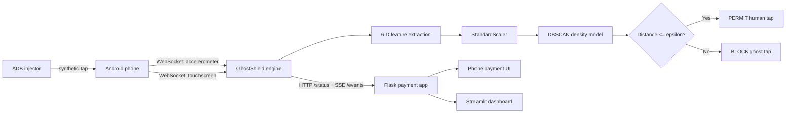

<div align="center">

# 🛡️ GhostShield

### Physics-aware protection against synthetic touch events

GhostShield is a real-time payment-security prototype that cross-checks what a
touchscreen reports against what the phone's inertial sensors physically
experienced. A software-injected tap can imitate a valid `MotionEvent`; it
cannot, by itself, create the mechanical impulse of a finger touching glass.

<p>
  
  
  
  
</p>

<p>
  <strong>Detect the missing physics, not just the malicious software.</strong>
</p>

</div>

---

## The idea

Traditional touch defenses ask whether a touch event looks valid. GhostShield
asks a harder question:

> **Did the device experience the physical consequences of the touch it just
> accepted?**

The system observes two channels at the same time:

| Channel | What it proves | Typical synthetic-tap signal |
| --- | --- | --- |
| Capacitive touchscreen | A tap event was delivered to the operating system | Present |
| Accelerometer | Mechanical motion followed the contact | Absent or near zero |

This distinction creates a useful security boundary. An attacker may be able
to reproduce coordinates, timing, pressure metadata, and application behavior,
but a remote `adb shell input tap`, accessibility action, or similar software
path does not transfer a finger's force into the chassis.

GhostShield is intentionally built as a demonstrable prototype: it makes that
invariant visible in a payment UI, a live dashboard, and a repeatable injection
script.

## How it works



### 1. Capture a synchronized observation window

The engine maintains a rolling accelerometer buffer. When an
`ACTION_DOWN` event arrives, it examines a ±150 ms window around that event and
uses a pre-tap slice to estimate the current gravity baseline. The baseline is
computed from the magnitude:

```text
M(t) = sqrt(x² + y² + z²)
```

Because the magnitude of gravity remains approximately constant under device
rotation, this is more robust than trusting one accelerometer axis.

### 2. Convert the event into measurable evidence

Each tap becomes a six-dimensional vector:

| Feature | Meaning |
| --- | --- |
| `Δt` | Time from the touch event to the strongest inertial response |
| `M_peak` | Maximum gravity-corrected inertial magnitude |
| `A_contact` | Contact-window size proxy |
| `F_pressure` | Force/pressure proxy derived from the inertial peak |
| `σ²_Z` | Variance of the Z-axis impulse |
| `impulse_dur` | Duration above 10% of the peak |

A physical tap should contain a coherent impulse. A software-only tap should
look close to the feature-space origin, especially in `M_peak`, `F_pressure`,
and `σ²_Z`.

### 3. Learn the local human-tap distribution

The first 15 accepted observations form the calibration corpus by default.
GhostShield standardizes that corpus, estimates `ε` from the 95th percentile of
4-nearest-neighbor distances, and fits DBSCAN with `min_samples=4`.

At inference time:

```text
scaled tap → nearest learned core sample → distance <= ε ? HUMAN : GHOST
```

This is not a hard-coded coordinate detector. It adapts to the user's device,
orientation, and normal tap dynamics while keeping the decision interpretable:
the dashboard can show the vector, the nearest-core distance, and the active
epsilon boundary.

## What is included

| Component | Role |
| --- | --- |
| `ghostshield_engine.py` | Sensor WebSocket clients, feature extraction, calibration, DBSCAN model, and decision event bus |
| `payment_app.py` | Flask server, mobile-first payment UI, status endpoint, SSE decision stream, and reset endpoint |
| `dashboard.py` | Read-only Streamlit projector dashboard with live metrics, feature-space plots, and event history |
| `ghost_injector.py` | ADB-based synthetic-tap demonstration with connection checks and guided narration |
| `test_sensor.py` | Connectivity smoke test for accelerometer and touchscreen WebSockets |
| `SensorServer/` | Android SensorServer application and companion Flutter dashboard used as the phone-side sensor source |

## Quick start

### Requirements

- Python 3.11 or newer
- An Android phone with USB debugging enabled
- The `SensorServer` Android app running on the phone
- Laptop and phone connected to the same reachable network, or USB tethering
- Android Platform Tools (`adb`) for the injection demo

### 1. Install Python dependencies

```bash
python -m venv .venv

# macOS/Linux
source .venv/bin/activate

# Windows PowerShell
# .venv\Scripts\Activate.ps1

python -m pip install --upgrade pip
python -m pip install -r requirements.txt
```

### 2. Configure the phone endpoint

Set `PHONE_IP` in `ghostshield_engine.py` and `test_sensor.py` to the hostname
or LAN address exposed by SensorServer. The default engine port is `8080`.

The engine currently resolves a Windows Mobile Hotspot hostname first and
falls back to a configured static address. For a different network, replace
the value with the phone's reachable address.

### 3. Verify sensor streaming

Run the smoke test before starting the payment demo:

```bash
python test_sensor.py
```

You should see accelerometer samples followed by touchscreen events when you
tap the phone. If the test cannot connect, fix networking or the SensorServer
address before continuing.

### 4. Start the payment surface

```bash
python payment_app.py
```

Open the printed URL on the phone, normally:

```text
http://<LAPTOP_IP>:5000
```

The payment application starts the engine once, serves the mobile UI, and
exposes the live decision state to the dashboard.

### 5. Start the observability dashboard

In a second terminal:

```bash
streamlit run dashboard.py
```

The dashboard polls `http://localhost:5000/status`; it does not start a second
engine process. Keep `payment_app.py` running first.

### 6. Calibrate

Make 15 natural taps on the phone. During calibration, the engine rejects
observations with unusually large inertial peaks or Z-axis variance so that an
obvious movement does not contaminate the human-tap corpus. Once calibration
completes, the UI changes to **SHIELD ACTIVE**.

## Running the ghost-tap demonstration

After the payment app and dashboard are running:

1. Confirm the phone is connected:

   ```bash
   adb devices
   ```

2. Confirm `TAP_X` and `TAP_Y` in `ghost_injector.py` match the payment button.
3. Run the guided injector:

   ```bash
   python ghost_injector.py
   ```

The script calls:

```bash
adb shell input tap <x> <y>
```

The UI may animate because Android received a valid synthetic touch event.
GhostShield should still observe no corresponding mechanical impulse and emit
an event shaped like:

```text
label = -1
distance > ε
decision = BLOCK
```

This is the central demonstration: **the operating system can accept the event
while the security gate rejects the transaction.**

## Local API

`payment_app.py` provides a small local control plane:

| Endpoint | Method | Purpose |
| --- | --- | --- |
| `/` | `GET` | Mobile payment UI |
| `/status` | `GET` | Current model state, counters, vectors, and latest decision |
| `/events` | `GET` | Server-Sent Events stream for `PERMIT` and `BLOCK` decisions |
| `/reset` | `POST` | Clears the current gate decision and drains stale queued events |

Example:

```bash
curl http://localhost:5000/status
curl -N http://localhost:5000/events
curl -X POST http://localhost:5000/reset
```

## Design decisions

### Why sensor fusion?

Touch metadata is close to the attacker's control surface. An attacker can
choose coordinates and often influence timing or event properties. The phone's
inertial response is a separate physical observation channel. Combining both
channels raises the cost of producing a convincing forgery because the attacker
must reproduce not only the software event, but also the device motion that a
real contact would cause.

### Why a rolling pre-tap gravity baseline?

Using a fixed `9.81` value is brittle across devices, sensor calibration, and
orientation. Using a long historical average can also absorb movement from
walking or handling the phone. GhostShield estimates gravity immediately before
the event, with a fallback to the available buffer for the first observation.

### Why DBSCAN instead of a binary threshold?

A single `M_peak` threshold is easy to explain but ignores timing, impulse
shape, and device-specific variation. DBSCAN models the density of normal taps
across all six features without requiring a large labeled attack dataset.
`epsilon` remains observable, and the nearest-core distance gives every
decision a concrete reason.

### Why separate the dashboard process?

The payment app owns the engine and its locks. The Streamlit dashboard is a
read-only HTTP consumer. This avoids accidentally creating a duplicate sensor
client or a second model when the dashboard reloads, and it makes the process
boundary explicit.

## Configuration reference

The most important engine controls are near the top of
`ghostshield_engine.py`:

| Setting | Default | Effect |
| --- | ---: | --- |
| `PHONE_IP` | device-specific | SensorServer host |
| `PORT` | `8080` | SensorServer WebSocket port |
| `WARM_UP_N` | `15` | Natural taps required before fitting |
| `WINDOW_SEC` | `0.150` | Half-width of the feature window |
| `WARMUP_MAX_MPEAK` | `2.0` | Calibration peak rejection limit |
| `WARMUP_MAX_SIGMA` | `1.5` | Calibration Z-variance rejection limit |
| `DEMO_PRELOAD` | `False` | Use a synthetic corpus for a presentation-only startup |

Use `DEMO_PRELOAD` only when a live calibration is not practical. A preloaded
corpus is useful for a deterministic demo, but it is less representative than
the actual phone, user, grip, and network conditions.

## Project layout

```text
.
├── ghostshield_engine.py       # Sensor fusion and anomaly model
├── payment_app.py              # Flask payment UI and local API
├── dashboard.py                # Streamlit live dashboard
├── ghost_injector.py           # ADB synthetic-tap demo
├── test_sensor.py              # SensorServer connectivity test
├── requirements.txt            # Python dependencies
└── SensorServer/               # Android sensor source and Flutter dashboard
    ├── app/                    # Android application
    ├── data/                   # Sensor/WebSocket services and repositories
    ├── ui/                     # Jetpack Compose screens
    └── sensors_dashboard/      # Flutter web dashboard
```

## Limitations and responsible use

GhostShield is a research and demonstration prototype, not a production
payment authorization system. In particular:

- The classifier depends on sensor quality, calibration quality, timing, and
  the phone's physical construction.
- A sophisticated attacker could attempt to create both a synthetic touch and
  a correlated physical disturbance; this design does not claim to solve that
  threat model.
- The local Flask server is intended for a trusted demo network. It does not
  provide production authentication, TLS termination, authorization, or
  transaction settlement.
- The feature model and thresholds require evaluation across devices,
  screen protectors, grips, accessibility tools, and environmental motion
  before any security claim is made.
- A `PERMIT` decision should be one signal in a layered fraud system, not a
  replacement for transaction limits, user verification, or server-side risk
  controls.

The strongest claim this repository supports is narrower and more useful:
**software-only touch injection leaves a measurable gap between capacitive
input and inertial evidence, and that gap can be surfaced in real time.**

## Development

Check Python syntax without connecting to a phone:

```bash
python -m compileall ghostshield_engine.py payment_app.py dashboard.py ghost_injector.py test_sensor.py
```

Run the interactive sensor smoke test with:

```bash
python test_sensor.py
```

For the Android component:

```bash
cd SensorServer
./gradlew test
```

The Android project also contains the Flutter sensor dashboard under
`SensorServer/sensors_dashboard/`; use the Flutter toolchain if you are
developing that subproject.

## Roadmap

- Evaluate false-positive and false-negative rates across a device matrix.
- Add signed, authenticated transport between the phone and the engine.
- Persist labeled tap traces for reproducible offline evaluation.
- Add adversarial tests for correlated physical and synthetic input.
- Move transaction authorization to a hardened server-side policy boundary.
- Add automated packaging for the Android sensor source and the Python demo.

## Contributing

Keep changes narrow and explain the security or measurement assumption they
affect. For model changes, include the feature definition, calibration impact,
and a reproducible test or trace. Never commit credentials, private device
addresses, sensor captures containing personal data, or production payment
secrets.

---

<div align="center">

**GhostShield · The tap may be synthetic. The physics is not.**

</div>
